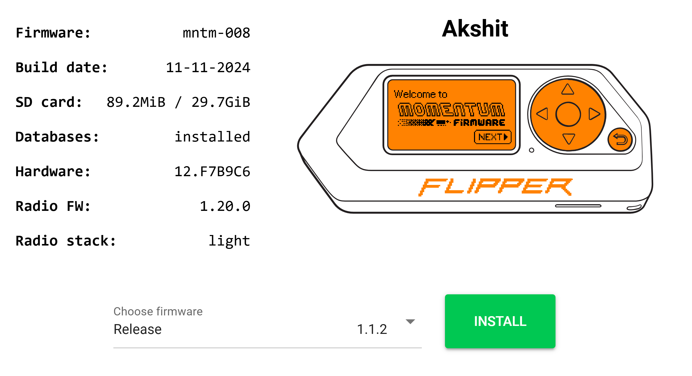
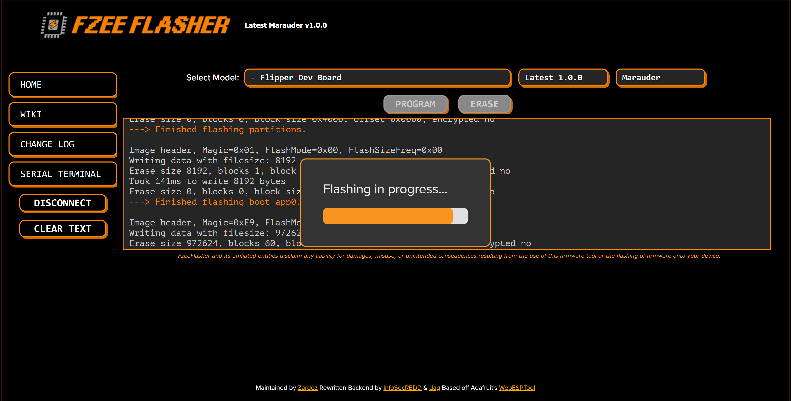
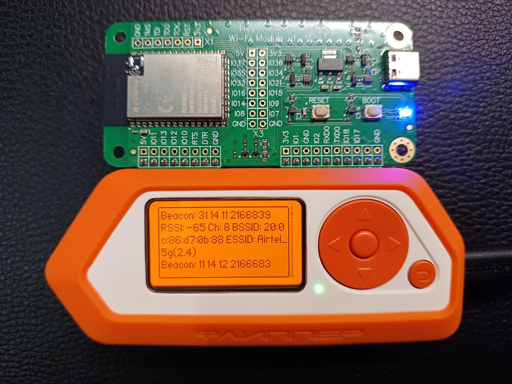

# Flipper Zero Wi-Fi Security Assessment — Deauthentication & WPA2 Handshake Cracking

> A hands-on wireless security assessment demonstrating the full attack chain against WPA2-PSK networks — from RF reconnaissance and active deauthentication to EAPOL/PMKID capture and offline password recovery — performed with a Flipper Zero and an ESP32 Wi-Fi development board running the Marauder firmware.

<p align="left">
  
  
  
  
  
  
  
</p>

<p align="center">
  
  <br>
  <sub><i>Flipper Zero paired with an ESP32 Wi-Fi dev board running Marauder — starting a PMKID sniff with active deauthentication.</i></sub>
</p>

---

## ⚠️ Legal & Ethical Disclaimer

This project was conducted **exclusively against networks and devices owned by the author**, strictly for **educational and defensive research purposes**. It is published to raise awareness of weaknesses in legacy wireless encryption and to promote stronger network hardening practices.

**Intercepting traffic, deauthenticating clients, or cracking credentials on networks you do not own or lack explicit written authorization to test is illegal** in most jurisdictions (e.g. the Computer Fraud and Abuse Act in the US, the Computer Misuse Act in the UK, and the Information Technology Act in India). The author assumes **no liability** for misuse of the information contained in this repository.

See [`DISCLAIMER.md`](DISCLAIMER.md) for the full statement. **Read it before proceeding.**

---

## Table of Contents

1. [Overview](#overview)
2. [Objectives](#objectives)
3. [Technical Background](#technical-background)
4. [Hardware & Software](#hardware--software)
5. [Attack Methodology](#attack-methodology)
6. [Walkthrough](#walkthrough)
7. [Results](#results)
8. [Defensive Recommendations](#defensive-recommendations)
9. [Skills Demonstrated](#skills-demonstrated)
10. [Repository Structure](#repository-structure)
11. [Documentation](#documentation)
12. [References](#references)
13. [License](#license)

---

## Overview

Wireless networks secured with **WPA2-PSK** remain the most widely deployed authentication scheme in home and small-business environments, yet the protocol's 4-way handshake exposes a recoverable cryptographic proof of the pre-shared key. This project reproduces the complete, real-world attack lifecycle an adversary would follow to compromise such a network:

```
Reconnaissance  →  Active Deauthentication  →  Handshake Capture  →  Format Conversion  →  Offline Cracking
   (scan APs)        (force re-association)      (EAPOL / PMKID)        (.pcap → .22000)       (hashcat)
```

The assessment is performed on a **Flipper Zero** paired with an **ESP32-based Wi-Fi development board** flashed with **[ESP32 Marauder](https://github.com/justcallmekoko/ESP32Marauder)** — a portable, low-cost toolkit that lowers the barrier to 802.11 attacks and therefore makes an excellent teaching platform for understanding (and defending against) them.

The entire workflow is documented step-by-step with annotated screenshots and hardware photographs in the [`docs/`](docs/) directory.

---

## Objectives

- Build a portable 802.11 security testing rig from a Flipper Zero and an ESP32 Wi-Fi dev board.
- Flash and configure custom device firmware (**Momentum** on the Flipper, **Marauder** on the ESP32).
- Perform passive reconnaissance to enumerate nearby access points and clients.
- Execute an **active deauthentication attack** to force a WPA2 4-way handshake.
- Capture **EAPOL** frames and opportunistic **PMKID** material and export them as `.pcap`.
- Convert captures into the hashcat **`22000`** mode format.
- Recover the pre-shared key offline and **quantify the cost of weak passwords**.
- Translate the findings into concrete **defensive hardening guidance**.

---

## Technical Background

### WPA2 4-Way Handshake

WPA2-PSK derives a **Pairwise Transient Key (PTK)** from the **Pairwise Master Key (PMK)**, which is itself derived from the SSID and the pre-shared passphrase via PBKDF2. During association, the client (supplicant) and access point (authenticator) exchange four EAPOL messages (**M1–M4**) carrying nonces and a **MIC** (Message Integrity Code). An attacker who captures this handshake obtains everything required to **brute-force the passphrase offline** — no further interaction with the network is needed.

| EAPOL Message | Direction | Contains |
|---------------|-----------|----------|
| **M1** | AP → Client | ANonce |
| **M2** | Client → AP | SNonce + MIC |
| **M3** | AP → Client | GTK + MIC |
| **M4** | Client → AP | ACK + MIC |

### Deauthentication

802.11 management frames are **unauthenticated** on WPA2 networks. By spoofing a deauthentication frame from the AP's BSSID, an attacker forcibly disconnects a client, which then **automatically re-associates** — replaying the 4-way handshake on demand so it can be captured.

### PMKID

The **PMKID** (Pairwise Master Key Identifier) is an optional field some APs include in the first EAPOL message (M1). Where present, it enables a **clientless attack**: the PMKID alone is sufficient to mount an offline dictionary/brute-force attack **without ever waiting for a client to connect**, further reducing the effort required.

> **Takeaway:** the security of a WPA2-PSK network collapses to the entropy of a single human-chosen passphrase. Everything in this project exists to demonstrate why that is a fragile assumption.

---

## Hardware & Software

### Bill of Materials

| Component                 | Role                         | Details                                                      |
| ------------------------- | ---------------------------- | ------------------------------------------------------------ |
| **Flipper Zero**          | Host controller / UI         | Running **Momentum Firmware** `mntm-008` (Radio FW `1.20.0`) |
| **ESP32 Wi-Fi Dev Board** | 802.11 radio / attack engine | "Flipper Zero Wi-Fi Module" — ESP32-WROOM based              |
| **Windows host (PC)**     | Flashing & offline cracking  | CP210x USB-UART bridge + hashcat                             |
| **USB-C cable**           | Power / data                 | Flipper ↔ PC                                                 |

### Software & Firmware

| Tool | Version | Purpose |
|------|---------|---------|
| [Momentum Firmware](https://momentum-fw.dev/) | `mntm-008` | Custom Flipper Zero firmware |
| [ESP32 Marauder](https://github.com/justcallmekoko/ESP32Marauder) | `v1.0.0` | 802.11 recon & attack firmware for the ESP32 |
| [FZEE Flasher](https://flipper.ee/flash) | Web (esptool) | Browser-based flasher for the Wi-Fi module |
| ESP Flasher (Flipper app) | `1.3.3` | On-device alternative to flash Marauder |
| [Silicon Labs CP210x VCP Driver](https://www.silabs.com/developer-tools/usb-to-uart-bridge-vcp-drivers) | `v11.3.0` | USB-to-UART bridge driver (Windows) |
| [hcxtools / cap2hashcat](https://hashcat.net/cap2hashcat/) | `hcxpcapngtool 6.3.1` | Convert `.pcap`/`.cap` → `.22000` |
| [REDD's PCAP OHC Uploader](https://github.com/InfoSecREDD) | `1.3` | Submit captures to OnlineHashCrack |
| [hashcat](https://hashcat.net/hashcat/) | — | Offline WPA2 key recovery (`-m 22000`) |

---

## Attack Methodology

```
┌──────────────────────────────────────────────────────────────────────────────┐
│  PHASE 0 — Platform Preparation                                                │
│    • Install Momentum firmware on Flipper Zero                                 │
│    • Install CP210x USB-UART driver on Windows host                            │
│    • Flash Marauder firmware to the ESP32 Wi-Fi dev board (FZEE / ESP Flasher) │
├──────────────────────────────────────────────────────────────────────────────┤
│  PHASE 1 — Reconnaissance                                                      │
│    • Scan AP  →  enumerate SSIDs, BSSIDs, channels, RSSI, encryption           │
│    • Select target access point                                                │
├──────────────────────────────────────────────────────────────────────────────┤
│  PHASE 2 — Active Capture                                                       │
│    • sniffpmkid -d -serial  →  PMKID sniff WITH deauthentication               │
│    • Force client re-association  →  capture EAPOL M1–M4 / PMKID               │
│    • Persist traffic to apps_data/marauder/pcaps  (.pcap)                       │
├──────────────────────────────────────────────────────────────────────────────┤
│  PHASE 3 — Conversion                                                           │
│    • cap2hashcat / hcxpcapngtool  →  extract handshake  →  .22000 hash file    │
├──────────────────────────────────────────────────────────────────────────────┤
│  PHASE 4 — Offline Cracking                                                     │
│    • hashcat -m 22000 handshake.22000 wordlist.txt                             │
│    • Recover pre-shared key  →  assess password strength                       │
└──────────────────────────────────────────────────────────────────────────────┘
```

---

## Walkthrough

The sections below summarise each phase. Full, screenshot-by-screenshot instructions live in the [`docs/`](docs/) directory.

### 1. Platform Preparation

The Flipper Zero runs the **Momentum** custom firmware, and the ESP32 Wi-Fi module is flashed with **Marauder** either via the web-based **FZEE Flasher** or the on-device **ESP Flasher** app (`Quick Flash → Flipper WiFi Devboard → Marauder`).

<p align="center">
  
  
</p>

➡️ See [`docs/01-hardware-and-firmware-setup.md`](docs/01-hardware-and-firmware-setup.md)

### 2. Reconnaissance

Using Marauder's **Scan AP** function, nearby access points are enumerated with their BSSID, channel, RSSI, and ESSID (e.g. a 2.4 GHz target on channel 8).

<p align="center">
  
</p>

➡️ See [`docs/02-reconnaissance.md`](docs/02-reconnaissance.md)

### 3. Deauthentication & Handshake Capture

The `sniffpmkid -d -serial` command starts a **PMKID sniff with active deauthentication** on the target channel. Deauth frames force clients to re-associate, and the resulting **EAPOL** handshakes are captured and saved as `.pcap`.

<p align="center">
  
  
</p>

➡️ See [`docs/03-deauth-and-capture.md`](docs/03-deauth-and-capture.md)

### 4. Conversion & Cracking

Captures are converted to the hashcat **`22000`** format using **cap2hashcat** (`hcxpcapngtool`). The extracted handshake is then fed to **hashcat** for offline key recovery.

<p align="center">
  
</p>

➡️ See [`docs/04-conversion-and-cracking.md`](docs/04-conversion-and-cracking.md)

---

## Results

- ✅ Successfully built and configured a portable 802.11 assessment rig (Flipper Zero + Marauder ESP32).
- ✅ Enumerated nearby access points, including a 2.4 GHz WPA2 target.
- ✅ Executed an active deauthentication attack and captured **valid EAPOL handshakes**.
- ✅ Converted the capture with `hcxpcapngtool 6.3.1` — **handshake extraction successful**, with an authorized `EAPOL M32E2` pair written to the `22000` hash file.

| Capture Metric                 | Value                      |
| ------------------------------ | -------------------------- |
| Packets inside capture         | 2,946                      |
| Unique ESSIDs observed         | 19                         |
| Beacon frames                  | 1,655                      |
| EAPOL messages (total)         | 21                         |
| EAPOL pairs written to `22000` | 1 (RC checked, authorized) |
| Link-layer type                | `DLT_IEEE802_11`           |

> The captured handshake was converted into a crackable hash, confirming the end-to-end viability of the attack chain against a legacy WPA2-PSK configuration.

---

## Defensive Recommendations

The purpose of reproducing this attack is to harden against it. Based on the findings:

| Mitigation | Why it works |
|------------|--------------|
| **Adopt WPA3 (SAE)** | Simultaneous Authentication of Equals is resistant to offline dictionary attacks — captured material is not crackable the same way. |
| **Use a long, high-entropy passphrase** | WPA2's resilience depends entirely on passphrase entropy. Use 16+ random characters; this makes offline brute-force computationally infeasible. |
| **Enable 802.11w (Protected Management Frames)** | PMF cryptographically protects management frames, **blocking the deauthentication attack** that forces handshake replay. |
| **Avoid predictable / default SSIDs** | The SSID is salt for the PMK; common SSIDs enable precomputed (rainbow) attacks. |
| **Prefer 802.1X / enterprise auth where possible** | Eliminates the shared-PSK weakness entirely. |
| **Keep router firmware updated** | Patches known RF and driver-level vulnerabilities. |
| **Monitor for deauth floods** | A sudden burst of deauth frames is a strong indicator of an active attack. |

---

## Skills Demonstrated

- **Wireless penetration testing** — 802.11 reconnaissance, deauthentication, handshake capture.
- **Firmware flashing & embedded tooling** — Momentum, Marauder, esptool-based flashers, CP210x driver stack.
- **Protocol analysis** — WPA2 4-way handshake, EAPOL message flow, PMKID, PCAP inspection.
- **Applied cryptography** — hashcat `22000` mode, offline PSK recovery, password-entropy risk assessment.
- **Defensive security** — translating offensive findings into actionable hardening controls.
- **Technical documentation** — reproducible, well-structured write-up of a complete attack lifecycle.

---

## Repository Structure

```
flipper-zero-wifi-security-assessment/
├── README.md                              # This file — project hub
├── DISCLAIMER.md                          # Full legal & ethical statement
├── LICENSE                                # MIT License
├── CONTRIBUTING.md                        # Contribution guidelines
├── .gitignore
├── docs/
│   ├── 01-hardware-and-firmware-setup.md   # Platform preparation
│   ├── 02-reconnaissance.md                # AP enumeration
│   ├── 03-deauth-and-capture.md            # Deauth + EAPOL/PMKID capture
│   ├── 04-conversion-and-cracking.md       # cap2hashcat + hashcat
│   ├── 05-defense-and-mitigations.md       # Hardening guidance
│   └── references.md                       # Tools, specs & further reading
└── assets/
    ├── screenshots/                        # Annotated workflow screenshots
    └── hardware/                           # Device / rig photographs
```

---

## Documentation

| Document | Contents |
|----------|----------|
| [01 — Hardware & Firmware Setup](docs/01-hardware-and-firmware-setup.md) | Momentum install, CP210x driver, Marauder flashing (FZEE & ESP Flasher) |
| [02 — Reconnaissance](docs/02-reconnaissance.md) | Scanning and enumerating access points |
| [03 — Deauthentication & Capture](docs/03-deauth-and-capture.md) | `sniffpmkid -d`, EAPOL/PMKID capture, saving PCAPs |
| [04 — Conversion & Cracking](docs/04-conversion-and-cracking.md) | `cap2hashcat`, OHC uploader, hashcat `-m 22000` |
| [05 — Defense & Mitigations](docs/05-defense-and-mitigations.md) | WPA3, PMF, passphrase entropy, monitoring |
| [References](docs/references.md) | Standards, tools, and further reading |

---

## References

- IEEE 802.11i — WPA2 / RSN specification
- [ESP32 Marauder — justcallmekoko](https://github.com/justcallmekoko/ESP32Marauder)
- [Momentum Firmware](https://momentum-fw.dev/)
- [hashcat — WPA/WPA2 mode 22000](https://hashcat.net/wiki/doku.php?id=cracking_wpawpa2)
- [hcxtools — ZerBea](https://github.com/ZerBea/hcxtools)
- [cap2hashcat online converter](https://hashcat.net/cap2hashcat/)

A full list is maintained in [`docs/references.md`](docs/references.md).

---

## License

Distributed under the **MIT License**. See [`LICENSE`](LICENSE) for details.

> **Reminder:** licensing covers the *documentation and materials in this repository* — it does **not** grant permission to attack networks you do not own. Always operate within the law.
