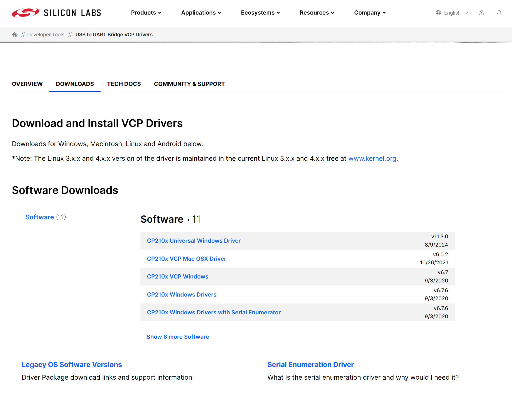
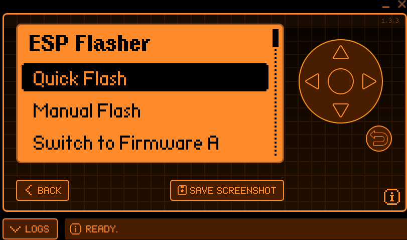
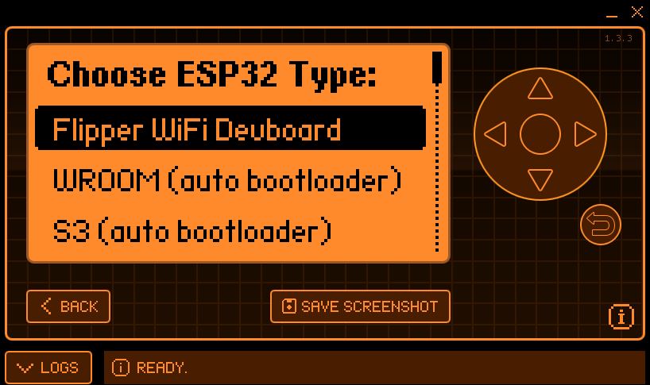
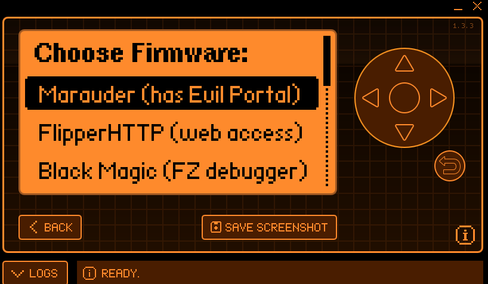

# 01 — Hardware & Firmware Setup

> Platform preparation: installing custom firmware on the Flipper Zero, the USB-UART driver on the host, and the Marauder firmware on the ESP32 Wi-Fi module.

[← Back to README](../README.md) · [Next: Reconnaissance →](02-reconnaissance.md)

---

## 1. Flipper Zero — Momentum Firmware

The Flipper Zero acts as the **host controller and user interface** for the Wi-Fi module. This project uses the **Momentum** custom firmware, which exposes the GPIO/UART bridge and bundles the companion apps (ESP Flasher, Marauder companion) needed to drive the ESP32 board.

| Field | Value |
|-------|-------|
| Firmware | `mntm-008` (Momentum) |
| Build date | 11-11-2024 |
| Hardware | `12.F7B9C6` |
| Radio FW | `1.20.0` |
| Radio stack | light |

**Steps:**
1. Download the Momentum firmware release from the [official updater](https://momentum-fw.dev/) or qFlipper.
2. Connect the Flipper Zero via USB-C and flash the release build.
3. Confirm the version from **Settings → About** (shown above).

---

## 2. Host Driver — Silicon Labs CP210x VCP

The ESP32 Wi-Fi dev board communicates with the Windows host over a **CP210x USB-to-UART bridge**. The corresponding **Virtual COM Port (VCP)** driver must be installed so the board enumerates as a serial device for flashing and serial capture.

| Driver | Version | Date |
|--------|---------|------|
| CP210x Universal Windows Driver | `v11.3.0` | 8/9/2024 |

**Steps:**
1. Visit the [Silicon Labs CP210x VCP Drivers page](https://www.silabs.com/developer-tools/usb-to-uart-bridge-vcp-drivers).
2. Download the **CP210x Universal Windows Driver**.
3. Extract and install (right-click the `.inf` → *Install*, or run the installer).
4. Verify the device appears under **Device Manager → Ports (COM & LPT)**.

---

## 3. ESP32 Wi-Fi Module — Marauder Firmware

The ESP32 board provides the actual 802.11 radio. It is flashed with **ESP32 Marauder**, which implements scanning, deauthentication, and PMKID/EAPOL sniffing. Two flashing paths were used.

### Option A — FZEE Flasher (web-based)

The [FZEE Flasher](https://flipper.ee/flash) is a browser-based esptool front-end. With the board connected, select the model and firmware and program it directly from the browser.

| Setting | Value |
|---------|-------|
| Model | Flipper Dev Board |
| Firmware | Marauder |
| Version | Latest `1.0.0` |

**Steps:**
1. Open [flipper.ee/flash](https://flipper.ee/flash) in a WebSerial-capable browser (Chrome/Edge).
2. **Select Model:** `Flipper Dev Board` · **Firmware:** `Marauder` · **Version:** `1.0.0`.
3. Click **PROGRAM** and select the board's COM port when prompted.
4. Wait for *"Finished flashing"* — the progress dialog confirms completion.

### Option B — ESP Flasher (on-device Flipper app)

Alternatively, the **ESP Flasher** Flipper application (v`1.3.3`) flashes the module directly from the Flipper Zero — no PC required.

**Steps:**
1. Launch **Apps → GPIO → ESP Flasher** on the Flipper.
2. Choose **Quick Flash**.
3. **Choose ESP32 Type:** `Flipper WiFi Devboard`.

   

4. **Choose Firmware:** `Marauder (has Evil Portal)`.

   

5. Confirm and wait for the flash to complete.

---

## Verification

After flashing, launch the Marauder companion on the Flipper (or connect over serial). The Marauder main menu should load, confirming the ESP32 is running the firmware and ready for reconnaissance.

➡️ Continue to [**02 — Reconnaissance**](02-reconnaissance.md).
