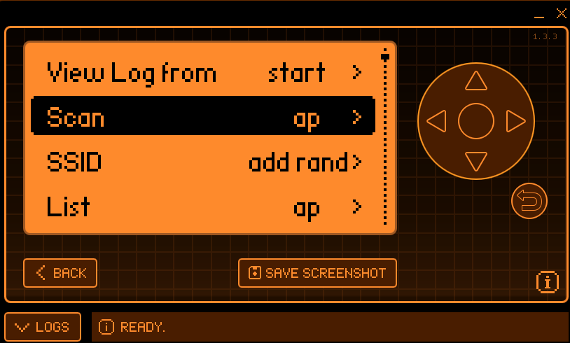

# 02 — Reconnaissance

> Passive enumeration of nearby 802.11 access points to identify a target for the handshake capture.

[← Previous: Setup](01-hardware-and-firmware-setup.md) · [Back to README](../README.md) · [Next: Deauth & Capture →](03-deauth-and-capture.md)

---

## Objective

Before any active attack, the surrounding RF environment is mapped to discover access points and gather the parameters needed to target one: **BSSID**, **channel**, **RSSI** (signal strength), and **ESSID** (network name).

## Scanning for Access Points

From the Marauder menu, the **Scan → AP** function sweeps the 2.4 GHz band and parses beacon frames broadcast by nearby routers.

| Menu Option | Action |
|-------------|--------|
| `View Log from` | Select capture log start point |
| **`Scan → ap`** | Enumerate access points via beacon frames |
| `SSID → add rand` | Manage SSID list |
| `List → ap` | Review discovered access points |

## Reading the Results

As the scan runs, discovered access points stream to the Flipper display. Each beacon reveals the fields required to select and target a network.

A representative captured beacon:

| Field | Example Value | Meaning |
|-------|---------------|---------|
| RSSI | `-65` | Signal strength (dBm) — closer to 0 is stronger |
| Channel (Ch) | `8` | 2.4 GHz channel the AP operates on |
| BSSID | `20:0c:86:d7:0b:88` | AP's MAC address |
| ESSID | `Airtel_5g (2.4)` | Human-readable network name |

> **Target selection:** a network with a strong RSSI and an identifiable channel is chosen so the deauthentication and sniff can be locked to the correct channel in the next phase.

## Operational Notes

- Marauder tags each entry with its channel; note it — the capture phase pins the sniff to a single channel for reliability.
- A *"Cannot connect to update server"* status line is normal and unrelated to scanning.
- Reconnaissance here is **passive** (listening to beacons only); no frames are transmitted until the capture phase.

➡️ Continue to [**03 — Deauthentication & Capture**](03-deauth-and-capture.md).
